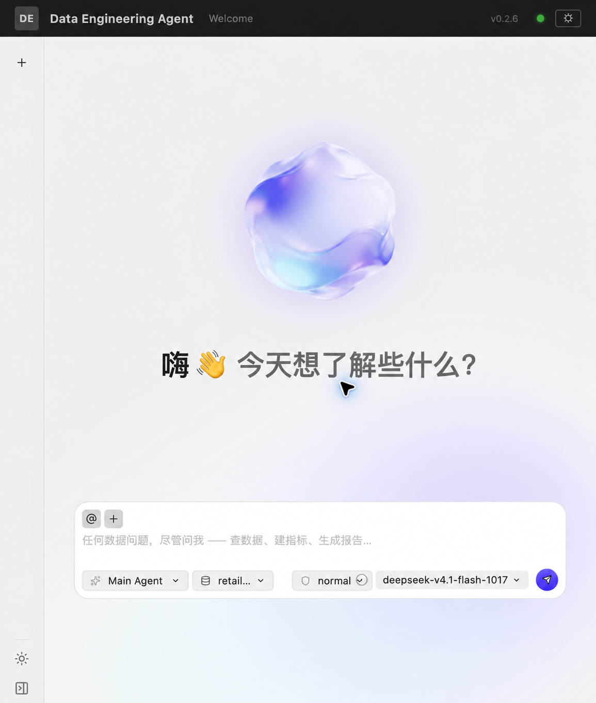

# DataEngineer Agent

[](https://www.python.org/downloads/)
[](LICENSE)

DataEngineer Agent 是一款开源的数据工程助手，帮助你用自然语言探索数据库、查询数据、生成并执行 SQL。项目提供交互式命令行、浏览器聊天界面、REST API 和 Model Context Protocol（MCP）服务。

## 功能

- 探索已连接数据库及其结构，并用自然语言提问。
- 生成和执行 SQL、查看查询结果、构建可复用的语义上下文。
- 通过 CLI、Web 界面、REST API 或 MCP 使用助手。
- 使用内置的合成电商演示数据库和加州学校历史数据。

## 界面截图



## 快速开始

### 环境要求

- Python 3.12 或更高版本
- [uv](https://docs.astral.sh/uv/)
- 支持的模型提供商 API 密钥，或可用的订阅/OAuth 授权

### 安装

```bash
git clone https://github.com/Huangbingshuai/data_engineer.git
cd data_engineer
uv sync --frozen
```

### 配置模型和数据源

创建或编辑本地配置文件 `conf/agent.yml`。Git 已忽略此文件，可用于保存本机配置和凭据。如果该文件已经存在，请合并以下配置项，不要直接覆盖原文件。

```yaml
agent:
  target: deepseek
  providers:
    deepseek:
      api_key: "YOUR_DEEPSEEK_API_KEY"
  services:
    datasources:
      retail_demo:
        type: duckdb
        uri: duckdb:///sample_data/retail_demo.duckdb
```

将占位内容替换为模型提供商密钥。项目也支持通过环境变量读取密钥。支持的提供商和环境变量名称见 [`conf/providers.yml`](conf/providers.yml)，完整配置示例见 [`conf/agent.yml.example`](conf/agent.yml.example)。请勿将真实凭据提交到 Git。

### 启动 Web 界面

```bash
uv run dataengineer-cli --web --config conf/agent.yml --datasource retail_demo
```

打开 [http://localhost:8501](http://localhost:8501)。Web 界面和 API 会一起启动。交互式 API 文档位于 [http://localhost:8501/docs](http://localhost:8501/docs)，健康检查地址为 [http://localhost:8501/health](http://localhost:8501/health)。在终端按 `Ctrl+C` 停止服务。

## 使用 CLI、API 和 MCP

### 交互式 CLI

```bash
uv run dataengineer-cli --config conf/agent.yml --datasource retail_demo
```

### REST API

以下命令将 API 绑定到本机回环地址 `127.0.0.1:8000`：

```bash
uv run dataengineer-api \
  --config conf/agent.yml \
  --datasource retail_demo \
  --host 127.0.0.1
```

- API 文档：[http://127.0.0.1:8000/docs](http://127.0.0.1:8000/docs)
- 健康检查：[http://127.0.0.1:8000/health](http://127.0.0.1:8000/health)

检查服务状态：

```bash
curl http://127.0.0.1:8000/health
```

如需后台运行，启动命令添加 `--daemon`。使用相同的配置路径查看或停止后台服务：

```bash
uv run dataengineer-api --config conf/agent.yml --action status
uv run dataengineer-api --config conf/agent.yml --action stop
```

默认日志文件为 `~/.dataengineer/logs/dataengineer-agent-api.log`。

### MCP 服务

若 MCP 客户端通过 stdio 启动本地进程，可使用：

```bash
uv run dataengineer-mcp \
  --config conf/agent.yml \
  --datasource retail_demo \
  --transport stdio
```

MCP 服务也支持 HTTP 和 SSE 传输。运行 `uv run dataengineer-mcp --help` 查看传输方式和监听地址选项。

## 示例数据

| 数据集 | 说明 |
| --- | --- |
| [`retail_demo.duckdb`](sample_data/retail_demo.duckdb) | 固定随机种子生成的合成巴西电商数据，包含 10,000 笔订单，所有身份记录均为虚构。运行 `uv run python scripts/create_retail_demo_db.py` 可重建；脚本会拒绝覆盖已有文件。 |
| [`california_schools_real.duckdb`](sample_data/california_schools_real.duckdb) | 历史学校目录及教育汇总数据。数据来源和处理说明见[数据集文档](sample_data/README_california_schools_real.md)。 |
| [`duckdb-demo.duckdb`](sample_data/duckdb-demo.duckdb) | 仓库内已有的 DuckDB 示例数据库。 |

要连接其他数据库，请在 `conf/agent.yml` 的 `agent.services.datasources` 下添加数据源，并通过 `--datasource` 指定名称。

## 开发

安装开发依赖并运行项目检查：

```bash
uv sync --frozen --dev
uv run ruff check .
uv run pytest tests/unit_tests
```

部分 embedding 相关测试首次运行时可能会下载模型文件。

## 项目结构

```text
conf/              配置示例和模型提供商目录
dataengineer/      Agent、CLI、REST API、MCP 服务及集成
sample_data/       示例数据库和数据集说明
scripts/           数据生成和维护脚本
tests/             单元、集成和回归测试
```

## 许可证

本项目采用 [Apache License 2.0](LICENSE) 开源。
